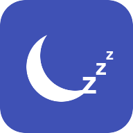

  

  

<h1 align="center">Sleep Tracking</h1>

Track each person's sleep sessions from a binary sensor that reports when they are in bed.

## Features

- **Sleep sessions:** Expose bed start, last sleep duration and last wake time for each person.
- **Interrupted sleep:** Keep brief absences in the same session using a configurable threshold.
- **Restart recovery:** Restore sleep state across Home Assistant restarts.
- **Multiple people:** Configure a separate in-bed sensor and entities for each person.

## Install

Use the Marketplace badge above on Home Assistant 2026.11 or later to add this
repository as a custom integration. On older versions, add it as a HACS
custom repository of type **Integration**. Install and restart Home Assistant.
The badge does not imply a public catalog listing.

## Quick start

1. Add **Sleep Tracking** under **Settings → Devices & services → Add integration**.
2. Enter a display name and select a binary sensor that is `on` when that
   person is in bed. Add more people as separate entries.
3. Review the **In bed**, **Bed start**, **Last sleep duration**, **Last wake
   time** and **Sleep interruptions** entities.

The interruption threshold and minimum sleep duration default to 30 minutes.
Sessions shorter than the minimum do not become the last sleep duration.
Reconfigure the entry if its in-bed sensor is replaced.
